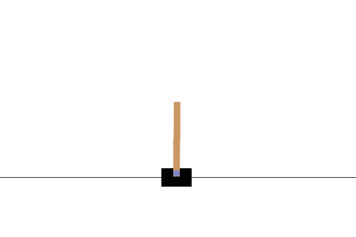
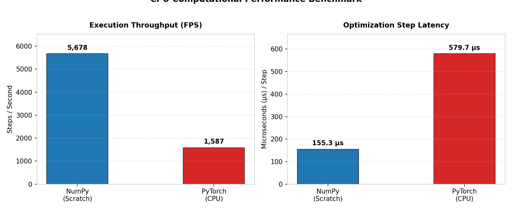
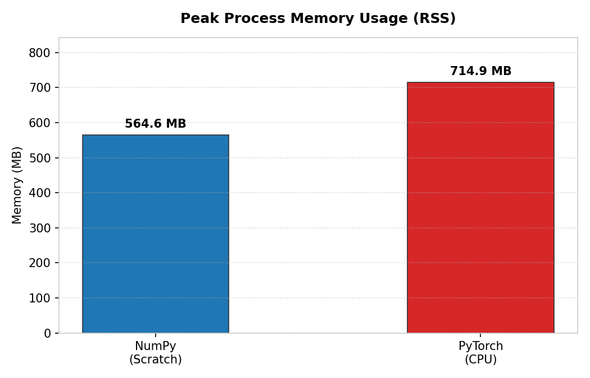

# CartPole-v1 DQN: NumPy (From Scratch) vs. PyTorch Benchmark

A comparative implementation of a **Deep Q-Network (DQN)** agent built both **purely from scratch in NumPy** (using analytical matrix backpropagation) and with the industry-standard deep learning framework (**PyTorch**), evaluated on the Gymnasium classic control environment `CartPole-v1`.

<p align="center">
  
</p>

---

## 📊 Benchmark Highlights (NumPy vs. PyTorch)

For small dense neural networks on CPU (such as our $4 \to 64 \to 2$ MLP), pure NumPy accelerated by OpenBLAS significantly outperforms PyTorch in execution speed due to C++ dispatch overhead and dynamic autograd graph allocation:

| Metric | NumPy (From Scratch) | PyTorch (CPU) | Comparison |
| :--- | :---: | :---: | :---: |
| **Training Throughput** | **5,678 steps/s** | 1,587 steps/s | **NumPy is 3.5x faster** ⚡ |
| **Optimization Latency (Per Step)** | **155.3 µs** | 579.7 µs | **NumPy has 3.7x lower latency** |
| **Peak Process RAM (RSS)** | **564 MB** | 714 MB | **NumPy is 21% lighter** |
| **Official Gymnasium Score (100 eps)** | **491.56 / 500** | **479.40 / 500** | **Both SOLVED ✅** ($\ge 475$) |
| **Gradient Divergence vs. PyTorch** | **$< 3 \times 10^{-7}$** | Reference | **Exact Mathematical Equivalence** |

<p align="center">
  
  
</p>

---

## 🔬 Numerical Gradient Equivalence Verification

To mathematically prove that the manual backpropagation implemented in NumPy is identical to PyTorch's C++ Autograd engine, `benchmarks/test_equivalence.py` initializes both models with identical weights and computes the maximum absolute parameter gradient divergence across an identical state-action batch:

$$\Delta_{\max} = \max | \nabla \theta_{\text{NumPy}} - \nabla \theta_{\text{PyTorch}} |$$

| Parameter | Tolerance | Max Divergence ($\Delta_{\max}$) | Status |
| :--- | :---: | :---: | :---: |
| **$W_1$ (Input $\to$ Hidden)** | $10^{-6}$ | $4.27 \times 10^{-8}$ | **PASSED ✅** |
| **$b_1$ (Hidden Bias)** | $10^{-6}$ | $7.05 \times 10^{-8}$ | **PASSED ✅** |
| **$W_2$ (Hidden $\to$ Output)** | $10^{-6}$ | $2.67 \times 10^{-7}$ | **PASSED ✅** |
| **$b_2$ (Output Bias)** | $10^{-6}$ | $1.80 \times 10^{-7}$ | **PASSED ✅** |
| **Forward Pass ($Q(s)$)** | $10^{-6}$ | $5.16 \times 10^{-7}$ | **PASSED ✅** |

---

## 📐 Theoretical Foundations & Algorithm

The project implements the canonical Deep Reinforcement Learning architecture directly via matrix operations:

### 1. Bellman Equation & Target Network
To stabilize training and decouple current action-value estimates from moving optimization targets:

$$y_i = r_i + \gamma \max_{a'} Q_{\text{target}}(s'_i, a'; \theta^-) \cdot (1 - \text{done}_i)$$

The Temporal Difference error (TD Error) is defined as:

$$\delta_i = Q(s_i, a_i; \theta) - y_i$$

### 2. Analytical Backpropagation in NumPy
The Q-network is a 2-layer MLP ($4 \to 64 \to 2$):
* **Hidden Layer**: $Z_1 = X W_1 + b_1$, $A_1 = \text{ReLU}(Z_1)$
* **Linear Output Layer**: $Z_2 = A_1 W_2 + b_2$

Gradients are computed analytically via tensor products:

$$\nabla_{W_2} = \frac{1}{B} A_1^T \delta \quad , \quad \nabla_{b_2} = \frac{1}{B} \sum \delta$$

$$\delta_{\text{hidden}} = (\delta W_2^T) \odot \mathbb{I}(Z_1 > 0)$$

$$\nabla_{W_1} = \frac{1}{B} X^T \delta_{\text{hidden}} \quad , \quad \nabla_{b_1} = \frac{1}{B} \sum \delta_{\text{hidden}}$$

### 3. Stabilization Techniques
* **He Initialization**: Weights are sampled from $\mathcal{N}(0, \sqrt{2/n_{\text{in}}})$ to preserve activation variance across ReLU layers and prevent vanishing/exploding signals.
* **Experience Replay Buffer**: Circular FIFO buffer with uniform sampling, decorrelating sequential transitions.
* **Gradient Clipping**: Gradients are clipped to $[-1.0, 1.0]$ to guard against destructive policy updates.

---

## 📁 Repository Structure

```text
CartPole/
├── src/
│   ├── common/                 # Shared RL components
│   │   ├── memory.py           # Circular FIFO Replay Buffer
│   │   └── utils.py            # Reproducibility seeds and smoothing helpers
│   ├── numpy_dqn/              # Pure NumPy implementation (from scratch)
│   │   ├── model.py            # Matrix MLP with He init
│   │   └── agent.py            # DQN agent and analytical backpropagation
│   └── torch_dqn/              # Reference PyTorch implementation
│       ├── model.py            # nn.Module MLP with Linear + ReLU
│       └── agent.py            # DQN agent with torch.optim
├── benchmarks/                 # Verification and benchmark suite
│   ├── test_equivalence.py     # Gradient equivalence proof (assert_allclose)
│   ├── run_benchmark.py        # Throughput (FPS), step latency and RAM profiler
│   ├── plot_benchmarks.py      # Publication-quality benchmark chart generator
│   └── benchmark_data.json     # Raw benchmark metrics
├── weights/                    # Trained checkpoints
│   ├── numpy_model.npz         # NumPy model weights (491.56/500 score)
│   └── torch_model.pt          # PyTorch model weights (479.40/500 score)
├── assets/                     # Media and benchmark figures
│   ├── cartpole_demo.gif       # Visual recording of trained agent
│   ├── benchmark_throughput.png# FPS and step latency chart
│   ├── benchmark_memory.png    # Process RAM comparison chart
│   └── benchmark_learning.png  # Comparative training curves
├── demo.py                     # Unified CLI for inference and rendering
├── main.py                     # Configurable training pipeline
├── requirements.txt            # Minimal dependencies
└── .gitignore                  # Ignored files
```

---

## 🚀 Getting Started

### 1. Installation

```bash
python3 -m venv .venv
source .venv/bin/activate
pip install -r requirements.txt
```

### 2. Verify Mathematical Gradient Equivalence

Run the unit test proving analytical NumPy gradients match PyTorch autograd to $< 10^{-6}$:

```bash
python benchmarks/test_equivalence.py
```

### 3. Evaluate and Visualize Trained Agents

Select the backend engine via `--backend`:

```bash
# Evaluate NumPy model in terminal
python demo.py --backend numpy --episodes 5

# Evaluate PyTorch model in terminal
python demo.py --backend torch --episodes 5

# Open real-time Pygame GUI window
python demo.py --backend numpy --render --episodes 3

# Record/update evaluation GIF
python demo.py --backend numpy --record-gif assets/cartpole_demo.gif
```

### 4. Reproduce Computational Benchmarks

```bash
python benchmarks/run_benchmark.py --episodes 400
python benchmarks/plot_benchmarks.py
```

### 5. Train from Scratch

```bash
# Train pure NumPy agent
python main.py --backend numpy --episodes 500

# Train PyTorch agent
python main.py --backend torch --episodes 500
```
